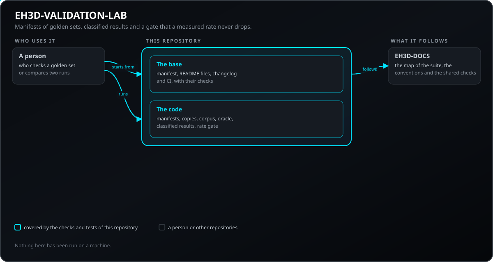
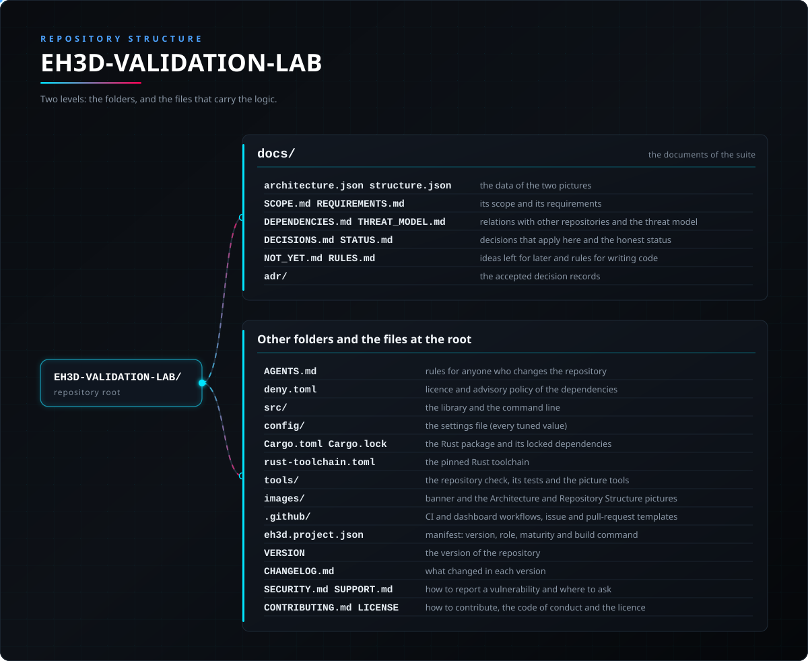

<p align="center">
  
</p>

# 🛠️ EH3D-VALIDATION-LAB

<p align="center"><a href="README.md">🇺🇸 English</a> | <a href="README_spa.md">🇪🇸 Español</a> | <a href="README_fra.md">🇫🇷 Français</a> | <a href="README_ita.md">🇮🇹 Italiano</a> | <a href="README_deu.md">🇩🇪 Deutsch</a> | 🇨🇳 <b>中文</b> | <a href="README_jpn.md">🇯🇵 日本語</a> | <a href="README_por.md">🇵🇹 Português</a></p>

### EH3D-VALIDATION-LAB：PHOENIX 系列的测试环境：带冗余副本的基准文件清单、分类的失败，以及保证已测得的通过率不会下降的关卡。早期代码。

<p align="center">
  
  
  
  
  
  
</p>

---

**诚实性核对 - 今天真正能运行的内容：** 一个小型 Rust 库及命令行，可编写并对照冗余副本校验基准文件集的校验和清单，读取要求每个失败都必须带有类别的结果文件，并通过关卡把一次运行与基线进行比较。它有 41 个自己的测试，在计算机上通过。它只用过自己的测试生成的数据：从未用于真实语料库或真实的基准文件集。它不读取任何设计文件，不运行任何参考工具，也还不比较任何设计工具的输出。案例精简器、不变量测试以及与基准文件的比较尚不存在。

---

> **安全（safety）与信息安全现状：** 本仓库刚刚起步，不是安全系统（safety）。这里写的任何内容都不能取代机床及其控制器的限位、联锁和急停。

## 📋 速览

| | |
|---|---|
| 版本 | `0.0.1` |
| 成熟度 | 脚手架 |
| 测试 | 44 |
| 技术栈 | Rust, Python 3.10+ |
| 真实硬件 | 尚未在硬件上运行 |

**跳转到：** [概述](#-概述) · [架构](#-架构) · [快速开始](#-快速开始) · [测试](#-测试) · [仓库结构](#-仓库结构) · [相关项目](#-相关项目)

## 🚦 项目状态

每一行是本仓库的一个部分，灯号表示它今天做到了哪一步。内容依据仓库能够展示的证据（测试、构建、运行），而不是计划。

🟢 已完成并验证 · 🟡 可用，有已知限制 · 🟠 部分完成或尚未验证 · 🔴 未完成或不可用

| 领域 | 状态 | 在这里的含义 |
|---|---|---|
| 仓库检查 | 🟡 | 仓库检查、图片检查以及基础部分的 3 个测试都在 CI 中运行并通过。 |
| 测试 | 🟡 | Rust 代码的 41 个测试和基础部分的 3 个测试在计算机上通过。它们只使用测试自己生成的数据；没有任何一个在真实语料库上运行过。 |
| 真实硬件 | 🟠 | 没有在任何机床或电路板上运行过：这里没有任何内容在硬件上试过。 |
| 计划的功能 | 🟠 | 已编写：基准文件集的清单、副本校验、分类的结果以及关卡。未编写：与基准文件的比较、案例精简器和不变量测试。 |
| 需求 | 🟠 | 6 项需求中有 4 项处于原型阶段，2 项仅为计划，没有一项已验证。 |

## 🎯 概述

* **已有的内容：** 一个库和一个命令行，没有窗口。它们编写并对照冗余副本校验基准文件集的 `SHA256SUMS` 清单，读取每个失败都带有三种类别之一的结果文件，并把一次运行与基线比较：每个级别已测得的通过率不得下降。报告只显示哈希、级别、类别和计数。
* **计划中：** 与基准文件的比较、案例精简器、设计模型不变量的具名测试，以及在适用时提供一种服务器任务。这些目前都还不存在。

## 🧩 在 EH3D 中的角色

EH3D-VALIDATION-LAB 是 EH3D Fabrication Suite 的 PHOENIX 系列的一部分。它将做什么、暂时不做什么、需求以及与其他仓库的关系都写在 `docs/` 文件夹中。

## 🏛️ 架构

<p align="center">
  
</p>

本仓库各部分如何协作：谁在使用它、它包含什么、它依赖什么。图片由 `docs/architecture.json` 绘制，并与代码核对。

## 🚀 快速开始

检查需要 Python 3.10 或更高版本，代码需要 Rust 工具链。

```bash
cargo build --release
cargo test
cargo run -- manifest <golden-folder>
python -I tools/ci_validate.py
python -I tools/make_architecture.py --check
python -I tools/make_structure.py --check --readmes
python -I -m unittest discover -s tools -p "test_*.py"
```

## 🧪 测试

代码有 41 个测试（`cargo test`），基础部分有 3 个（`python -I -m unittest discover -s tools -p "test_*.py"`）；全部在计算机上通过。CI 运行仓库检查、图片检查、基础部分的测试，并对 Rust 代码在 Linux 和 Windows 上运行格式检查、把警告当作错误的 clippy 以及测试。

## 🏗️ 构建与发布

版本号位于 `VERSION` 文件和 `eh3d.project.json`，每个版本在 [CHANGELOG.md](CHANGELOG.md) 中都有条目。`cargo build --release` 构建库和 `eh3d-validation-lab` 程序；版本发布在 GitHub 上。

## 📂 仓库结构

<p align="center">
  
</p>

<details>
<summary>目录树的文本版</summary>

```text
EH3D-VALIDATION-LAB/
├── docs/
│   ├── architecture.json structure.json         两张图的数据
│   ├── SCOPE.md REQUIREMENTS.md                 范围和需求
│   ├── DEPENDENCIES.md THREAT_MODEL.md          与其他仓库的关系和威胁模型
│   ├── DECISIONS.md STATUS.md                   适用的决策和如实的状态
│   └── NOT_YET.md RULES.md                      留待以后的想法和编写代码的规则
├── src/                                         库和命令行
├── config/                                      设置文件（所有调整值）
├── Cargo.toml Cargo.lock                        Rust 包及其锁定的依赖
├── tools/                                       仓库检查、其测试以及图片工具
├── images/                                      横幅图以及架构和仓库结构图片
├── .github/                                     CI 与仪表板工作流、Issue 和 PR 模板
├── eh3d.project.json                            清单：版本、角色、成熟度和构建命令
├── VERSION                                      仓库的版本
├── CHANGELOG.md                                 每个版本的变更
├── SECURITY.md SUPPORT.md                       如何报告漏洞及在哪里提问
└── CONTRIBUTING.md CODE_OF_CONDUCT.md LICENSE   参与贡献、行为准则和许可证
```

</details>

## 🗺️ 路线图与已知限制

**目前已知的限制**

* 早期代码：只在它自己的测试生成的数据上运行过，从未用于真实语料库或真实的基准文件集。
* 它检查副本包含相同的字节；把副本放在不同介质上由所有者负责。
* 与基准文件的比较、案例精简器和不变量测试尚未编写。

**下一步**

* 待本项目所依赖的契约被接受后，再编写与基准文件的比较和不变量测试（见 `docs/DEPENDENCIES.md`）。

## 🌍 语言

README 和文本提供英语、西班牙语、法语、意大利语、德语、汉语、日语和欧洲葡萄牙语版本。

## 🔗 相关项目

* [EH3D-DOCS](https://github.com/JuanenRac/EH3D-DOCS)：套件地图、架构、约定和共享检查
* 计划中的关系，尚未构建（EH3D-PHOENIX-PCB, EH3D-COMMON）：见 [docs/DEPENDENCIES.md](docs/DEPENDENCIES.md)

## 📚 文档

* [套件的约定](https://github.com/JuanenRac/EH3D-DOCS/blob/main/docs/CONVENTIONS.md)
* [变更日志](CHANGELOG.md)
* [范围、需求、依赖、威胁模型和决策](docs/SCOPE.md)

## 🤝 参与贡献与社区

* 提交 pull request 之前运行 `python -I tools/ci_validate.py` 和基础部分的测试：必须全部通过。见 [CONTRIBUTING.md](CONTRIBUTING.md) 和[行为准则](CODE_OF_CONDUCT.md)。
* README 有八种语言：修改文字时要同步修改全部八个文件，两张图片由 `tools/make_architecture.py` 和 `tools/make_structure.py` 根据 `docs/architecture.json` 和 `docs/structure.json` 绘制。
* 请私下报告漏洞：[SECURITY.md](SECURITY.md)。问题、想法和报告：electrohobby3d@gmail.com（[SUPPORT.md](SUPPORT.md)）。

## 👤 作者

**JuanenRac (Electro Hobby 3D)** · electrohobby3d@gmail.com

## 📜 许可证

软件：GPL-3.0-or-later。见 [LICENSE](LICENSE)。套件的硬件设计使用 CERN OHL-S。
